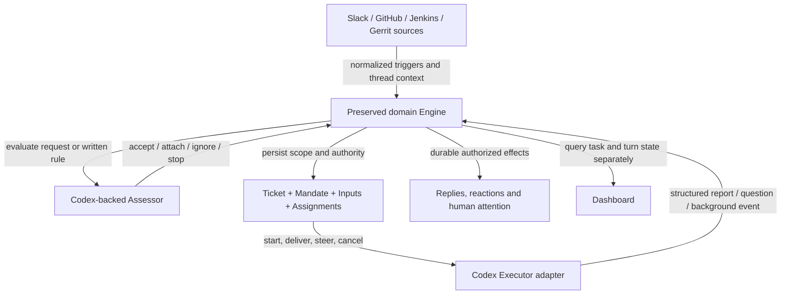

# 008 Architecture difference and critical review

Review date: 2026-11-04. Upstream baseline: [`6337fc823ce20251c8de8085948165c81aaa701e`](https://github.com/deepseek-ai/dsh-superagent-prototype/tree/6337fc823ce20251c8de8085948165c81aaa701e). Fork reviewed through `90e07dad61cc773791b4dc21d6690f1ef7c74f53`, plus the bounded review fixes below. [Current architecture](008-architecture_new.md) · [Visual review](architecture-review.html).

**Verdict: execution and several integrations work within a reduced contract; original-principle fidelity fails.** Passing the standalone tests does not establish parity. Preserve the original [philosophy](000-philosophy.md), [authorization](002-authorization.md) and [execution lifecycle](003-execution.md) as requirements. Missing task ownership, truthful outcomes and continuation are required restoration work.

## What was actually replaced

```mermaid
flowchart TB
  subgraph upstream[Original implementation]
    U[Sources] -->|submit triggers| E[Domain Engine]
    E -->|evaluate authority and scope| P[Policy / Assessor / Mandate]
    P -->|authorize ongoing work| T[Ticket + Inputs + Assignments]
    T -->|execute and receive reports| D[DSH Executor]
    D -->|waiting / question / blocked / ready| E
  end
  subgraph fork[Current standalone fork]
    S[Slack / CI / Gerrit adapters] -->|normalize events| I[Store intake and mode gate]
    I -->|create execution record| Q[Single-worker queue]
    Q -->|start or resume| C[Codex Executor]
    C -->|turn completed or failed| I
  end
```

The fork did not replace only `DshExecutor`. It introduced a parallel controller in `service/` and left the original Engine unused. `src/` and original numbered architecture documents remain unchanged from the upstream baseline. README and the first implementation plan disclose reduced parity, but that disclosure does not satisfy the requested original behaviour.

The original `src/core` imports internal modules and `node:crypto`; it does not require the DSH runtime directly. Its ports already separate repositories, policy, source scope, assessment, execution and replies. Reusing that domain is the preferred restoration path. The surrounding DSH session hooks, tools and UI still need adapters; changing an executor class alone will not port them.

## Changes and useful additions

“Added” describes capability in this fork, not a benchmark or an assertion that it is superior to upstream.

| Area | Change | Benefit | Cost or gap |
|---|---|---|---|
| Runtime | Separate Node/SQLite service with Codex app-server | Runs without Harness | Replaced original orchestration rather than adapting its ports |
| Slack | Socket Mode, exact allowlists, plain thread replies | Adds requested chat platform | Does not implement full task ownership, context fetching or handback |
| Conversation persistence | Saved Codex thread + retained workspace across replies | Fixes repeated loss of context | Per-message tickets remain; active steering absent |
| Reactions | Durable eyes/done/x delivery | Progress on the triggering message | Completion describes a turn, not a verified goal |
| CI | GitHub Actions and standard Jenkins/CloudBees readers | Deterministic monitoring without model calls per poll | Bounded windows; metadata only; no written-rule evaluator |
| Gerrit / Git | Patchset observations and generic local Git identity checks | Adds requested SCM support | Observation only; no review lifecycle or cross-provider correlation |
| Isolation | Dedicated home, minimal environment, sanitized clones, profile checks | Reduces credential/config inheritance | Broad reads and automatic escalation still need OS isolation; copied history consumes disk |
| Operations | systemd, Docker/Compose, private configuration and authentication | Repeatable VM setup | Native binary version is operator-selected and protocol-checked; container sandbox compatibility varies |
| Observability | Whole-store counters, readable Inspect, delivery retries and usage | Explains execution and delivery independently | No individual tool trace; task-level outcome remains missing |
| Documentation/workflow | Pinned skill inventory, public-identity/privacy checks, TDD and CI | Repeatable contribution process | Skills do not implement missing runtime behaviour |

## Independent review method

Separate reviewers were given the upstream baseline and current code, without an instruction to confirm the parent's conclusion:

- Sol: lifecycle, domain contracts, policy and recovery; read-only first, with isolated executable counterexamples.
- Terra: connectors, authorization boundaries, delivery, configuration and egress; fixture reproductions and official API references.
- Luna: test execution, real no-inference Codex protocol check, packaging and skill provenance inventory.

The integrator checked findings against callers and code, and separated defects from documented release boundaries. Review covered fork runtime, adapters, API/UI, deployment and public documentation changes. The original bundle was compared for required behaviour; it was not deployed. All 59 vendored skills were inventoried for provenance/licenses, not executed or fully audited semantically. This is a code/behaviour review, not a penetration test, traffic capture or certification.

## Must restore before claiming original-principle fidelity

| Finding | Concrete failure | Evidence | Required acceptance gate |
|---|---|---|---|
| P1 — Active corrections wait | “Stop; wrong branch” becomes a queued second execution while the first keeps running | Held-executor reproduction; `service/core/runtime.mjs` scheduling and `store.mjs` intake | In-scope correction reaches active work; authorized stop promptly interrupts the owned task |
| P1 — Blockers become successes | A completed turn returning “Blocked: which branch?” is saved and announced as succeeded | Executable fake-executor reproduction; runtime terminal update and store outbox | Structured blocked/question/ready/dropped reports; one stored question; no prose-keyword guessing |
| P2 — No continuing task authority | Cancelled execution's conversation can accept another plain message and resume | Runtime cancellation, conversation mapping and existing cancellation tests | Separate turn interruption from task stop; stopped work requires fresh acceptance |
| P2 — Proactivity lacks written-rule assessment | `auto` queues qualifying CI failures without a matched rule, scoped Mandate or policy version | Store CI gate, config schema; upstream Evals/Mandate absent | Record matched rule, scope and decision; observe reports what that rule would accept; revalidate when required |
| P2 — Routine chat becomes work/noise | “Thanks” in an authorized thread creates another execution and terminal reply | Slack intake and unconditional terminal outbox | Existing worker can consume context or drop non-actionable input without a new actionable task/result message |
| P2 — Recovery abandons active work | Restart marks running records interrupted; no same-task retry endpoint exists | `recoverRunning`, runtime tests and server routes | Durable inputs and task identity survive; recovery reconciles existing effects before continuation |
| P2 — Reply ordering has no task boundary | A ready followup reply can overtake an earlier delayed reply in the same thread | Independent due/retry fixture; existing Monitor skip-delayed behaviour | Preserve per-task ordering with an explicit policy for a repeatedly failing head message |
| P2 — Background completion has no owner | Turn teardown terminates the process group; no job completion wakes the ongoing task | Executor `finally` and disabled multi-agent feature | Bounded background job ownership, completion wakeup, cancellation and truthful final outcome |

These are not hidden upstream defects. Several reduced behaviours are intentionally asserted by current tests. Restoring parity means changing the domain and tests together, not adding prompts that ask the model to compensate.

## Concrete implementation defects found

### Fixed in this review

1. **Delayed replies starved ready replies.** The worker selected the oldest 20 pending messages before checking retry time. If all 20 were delayed, ready message 21 never sent. The worker now selects due rows before applying the batch limit; default pending inspection remains unchanged. A real Store + Monitor regression failed with zero sends before the fix, then passed with the ready message delivered and delayed attempts unchanged.
2. **Saved settings could be unusable.** Configuration accepted provider values rejected later by the connectors, including GitHub page counts over the poller's limit. Validation is aligned with the adapters; regression tests cover the rejected values and valid boundaries. Exact validation evidence is recorded with the change.

### Still open; do not claim end-to-end correctness for these scenarios

3. **P2 — GitHub selector aliases can duplicate a failure.** Configuring a workflow by both filename and numeric ID produces different job keys for the same run/attempt. The independent fixture produced two tickets. Normalize canonical run/workflow identity and deduplicate across aliases; preserve existing durable identities during migration. Source: `service/connectors/ci.mjs`, GitHub job construction; Store CI build key.
4. **P2 — Gerrit can label old patchsets newly observed.** A change outside the initial bounded window can move into it after an update. `ALL_REVISIONS` then supplies both earlier and new patchsets, and the earlier ones were never baselined. The fixture produced observations for both patchsets. A durable initial-history boundary must account for revision timestamps, server clock and polling races. Switching to only the current revision would lose legitimate intermediate updates. Source: Gerrit adapter, Monitor baseline and Store intake.
5. **P2 — An out-of-order Slack reply can be lost.** A plain reply delivered before its root mention is authorized gets acknowledged and discarded. The fixture accepted the root only. No ordering guarantee was established from Slack documentation; occurrence frequency is unverified. Hold bounded pending candidates and promote only after the exact root is authorized; keep user/channel checks and expiry.
6. **Authority revalidation gap.** A request accepted while paused can execute after restart even when its sender has been removed from the allowlist. The fixture executed the queued request because intake-time authorization was retained. Current docs describe intake filtering, so this is not proof of bypassing the stated intake contract. The faithful design must apply upstream Mandate revalidation rules and define the effect of permission changes on queued/active work.

7. **P2 — One failed GitHub workflow selector stalls healthy peers.** A working workflow and another returning 404 produce an unhealthy aggregate snapshot; Monitor discards the successful workflow’s new failure too. Removing the bad selector changes the baseline key and can hide failures from the outage. Track health and baseline per workflow selector, with a regression for independent progress and recovery. Source: GitHub polling aggregation and Monitor snapshot gate.

Observe mode is the documented default. Observation reduces automatic-execution exposure, but does not fix historical observations, duplicate records, missing replies or authority semantics.

## Verification evidence

| Path | Evidence | What remains unproven |
|---|---|---|
| Standalone service | Baseline review: 93 service tests passed; after review fixes, 97 service + 3 deployment tests passed | Original lifecycle parity; tests intentionally encode some reduced semantics |
| Deployment | 3 tests passed; shell syntax checked | Local systemd parser unavailable; exact host installation still requires its own check |
| Real Codex protocol | Start → synthetic persisted history → Codex app-server subprocess restart → resume passed; both inference requests intercepted | Model behaviour, tool enforcement and real service-crash recovery are not established by this smoke |
| Codex/Slack live path | Private operational evidence rechecked: plain followup recalled prior marker, same session/workspace, replies sent; source-directory check succeeded | Broad task quality, active steering, structured reports and all failure modes |
| Slack reactions | Live eyes-to-done transition previously observed; durable retry/fallback tests pass | Out-of-order intake race remains open |
| GitHub Actions | Fixture checks plus a read-only real-adapter probe against this public repository: 5 events, healthy snapshot, expected bounded-coverage warning | No enabled source in the deployment; aliases and per-workflow failure isolation remain open |
| Jenkins / CloudBees | Fixture nested jobs, queue/build correlation, auth construction and failure states | No live configured source; historical repository provenance prevents automatic repair |
| Gerrit | Fixture prefix parsing, paging, scope, patchsets and deduplication | No live configured source; moving-window history issue remains open |
| Generic Git | Real temporary-repository tests and private live sanitized clone/source access | Untracked files, fetched revisions and submodule/dependency bootstrap |
| Dashboard | Browser observability regression previously passed; syntax and API tests pass | No per-tool trace or task-level human-attention lifecycle |
| Packaging/privacy | Package/lock consistency, secret-pattern scan, declared egress and skill provenance checked | Full vendored-skill audit, packet capture, OS isolation and all dependency vulnerabilities |

Live operational identifiers, hosts, paths, logs and credentials are kept outside this public repository. Successful historical evidence is labelled as such; an installed MCP/CLI alone is not evidence that the deployed connector uses it. Context7 was unavailable in this review environment.

## Restore the original domain around the new adapters

**This diagram is the required target, not the deployed topology.** Preserve working Codex, Slack, provider normalization, deployment and privacy controls while replacing the parallel controller with ports around the original domain.

1. **Lock the domain contracts first.** Turn the failing scenarios above into acceptance tests around the preserved Engine. Retain original source tests for ownership, followups, policy, reports and recovery. Service-only green CI is insufficient for this migration.
2. **Port persistence and effects.** Persist original task/input/assignment/decision identities; migrate current execution records as historical turns. Do not invent past mandates, merge unrelated sessions or silently replay prior effects. Migration must be backed up, repeatable and reversible before deployment.
3. **Adapt Codex lifecycle.** Map start/resume, input delivery/steering, structured reports/questions, cancellation and bounded background completion to the Engine ports. Prove each capability against the pinned binary. Preserve permission checks; interactive authority must not become blanket approval.
4. **Adapt sources and policy.** Give source events stable identities and correlated Threads; port authorization and written-rule evaluation. Jenkins/Gerrit metadata gaps stay explicit. Existing MCP/CLI access can supply approved evidence through a bounded adapter; it is not a replacement for durable intake/deduplication.
5. **Restore human-facing semantics.** Show continuing tasks, pending questions, blockers and review needs. Keep individual turns and protocol/session IDs inside inspection. Replies should carry useful results, not raw execution UUID/status prefixes. A completion marker must distinguish a completed turn from completed work.
6. **Prove migration and host behaviour.** Exercise cross-turn, active correction, stop, policy change, restart, duplicate delivery, background completion and source failures. Reuse private deployment checks; keep public examples synthetic. Only then claim original-principle parity.

## Sources and maintenance

- Preserved requirements: [philosophy](000-philosophy.md), [domain](001-domain.md), [authorization](002-authorization.md), [execution](003-execution.md), [prompts](004-prompts.md), [architecture](007-architecture.md).
- Implementations: [`src/core/`](../src/core/), [`service/core/`](../service/core/), [`Codex adapter`](../service/codex/executor.mjs), [`connectors`](../service/connectors/), [`Monitor`](../service/monitor.mjs), [`configuration`](../service/config.mjs).
- Official external semantics: [Slack Events API](https://docs.slack.dev/apis/events-api/), [Gerrit change queries](https://gerrit-review.googlesource.com/Documentation/rest-api-changes.html#list-changes), [Gerrit revision timestamps](https://gerrit-review.googlesource.com/Documentation/rest-api-changes.html#revision-info).
- [Verification record](fork/verification.md) keeps commands/results. [AGENTS.md](../AGENTS.md) requires these documents and the visual companion to change with architecture, source contracts, state semantics or permissions.
