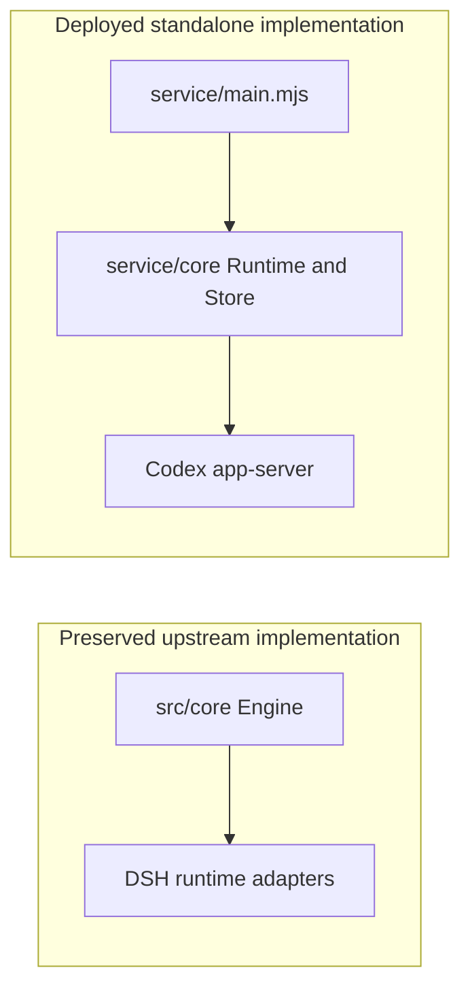
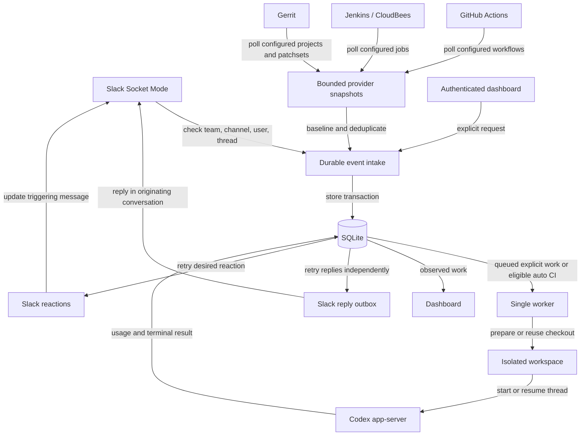
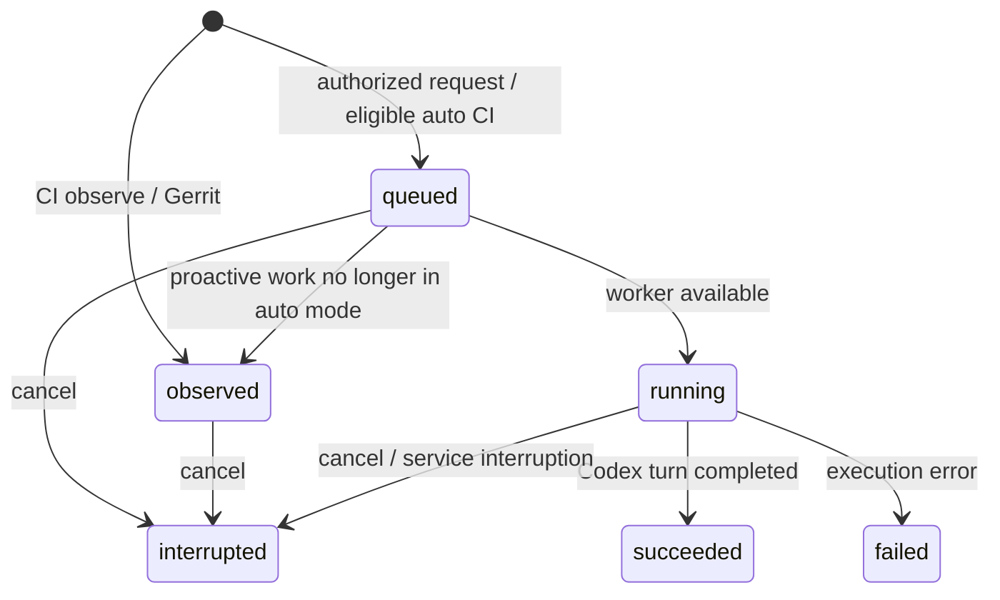

# 008 Fork architecture: what runs today

Review date: 2026-11-04. Implementation baseline: `90e07dad61cc773791b4dc21d6690f1ef7c74f53` (PRs #1–#9). Review fixes are recorded in the [difference and findings document](008-architecture_diff.md).

**This is a working Codex execution service with partial conversation continuity. It does not yet implement the original superagent task lifecycle.** The original [philosophy](000-philosophy.md) remains the product contract. The missing behaviour is required parity work, not a new definition of the product.

Read this for current behaviour; read [008-architecture_diff.md](008-architecture_diff.md) for changes, evidence and the restoration path. [Visual companion](architecture-review.html). The upstream numbered documents and `008-cookbook.md` remain unchanged.

## Two implementations exist; only one runs



The service entry point imports `service/`, not `src/core/Engine`. Keeping the upstream source in Git preserves attribution and reference material; it does not inherit its behaviour at runtime. The new service requires Node 24+ and its Slack Socket Mode dependency. DeepSeek Harness is not installed or invoked by this entry point.

## Incoming messages and events become execution records



Polling uses no model tokens. It retrieves a bounded recent window, not a lossless history. The first healthy snapshot establishes a baseline. Failed/incomplete transport snapshots do not advance that baseline; coverage truncation is reported separately. A new failure may become observed or queued, depending on the mode. Gerrit patchsets remain observed in every mode.

`observe` means the service records CI failures; it does not run the upstream model-based “would accept under rule X” assessment. `auto` permits qualifying CI failures to queue; there is no written-rule evaluator or durable Mandate. `paused` stops new worker execution, but is not a durable stop of each conversation and does not implement upstream's full processing pause.

## A Slack conversation now survives multiple turns

```mermaid
sequenceDiagram
  participant H as Allowed person
  participant S as Slack intake
  participant DB as SQLite
  participant C as Codex
  H->>S: Mention + request
  S->>DB: Store event and ticket A; queue eyes
  DB->>C: Start thread in isolated checkout
  C->>DB: Save session ID and result
  DB-->>H: Reply and terminal reaction
  H->>S: Plain reply in same authorized Slack thread
  S->>DB: Store ticket B; resolve conversation mapping
  DB->>C: Resume same session and checkout
  C->>DB: Save new result and per-turn usage
  DB-->>H: Reply to same Slack thread
```

Three identities have different jobs:

| Identity | Meaning | Current lifetime |
|---|---|---|
| Slack thread | Where the conversation occurs | Team + channel + root message timestamp |
| Service ticket | One accepted message/execution record | A new record for each accepted message |
| Codex thread | Saved model conversation | Reused by the mapped Slack conversation |

This repairs context loss but still differs from upstream: its Ticket is the continuing unit of authorized work, with multiple Inputs and Assignments. The current service has no corresponding durable goal/task object above its execution records.

Replies arriving during a turn wait in the global queue. They do not steer the active Codex turn. One Slack thread cannot currently route distinct scopes to different owning tasks. A cancellation stops one execution record; it does not withdraw ongoing conversational authority. Legacy recovery selects the latest matching saved session; it does not merge old independent conversations.

Keep SQLite, the dedicated Codex home and retained workspaces together. Missing or mismatched saved state fails closed. One application process is started per turn; the saved Codex conversation persists across those processes.

## Turn completion is not task completion



These are execution states. `succeeded` proves that the Codex turn completed; a model reply saying “blocked” does not create a blocked task. There is no structured `waiting`, `blocked`, `ready`, question/answer or review lifecycle yet. The dashboard, completion reaction and estimated benefit must not be interpreted as proof that a user's goal or CI repair succeeded.

Accepted Slack messages receive `eyes`. Completed turns receive `done` (checkmark fallback when unavailable); failures/interruption receive `x`. Reactions target the triggering message, not always the thread root. Reaction retries and reply retries are separate from model execution. Ambiguous network responses can still duplicate replies. A ready reply can overtake an earlier delayed reply; per-task ordered delivery is not implemented.

## What each connector provides

| Connector | Current capability | What it does not supply |
|---|---|---|
| Slack | Authorized mentions, plain replies in joined threads, bounded forwarded text, replies and reactions | Full remote history retrieval, arbitrary channels, upstream task ownership/handback |
| GitHub Actions | Workflow run/attempt states, repository/SHA metadata, bounded polling | Issue/review conversation sources, full logs/artifacts, pushes/PR creation/merges |
| Jenkins / CloudBees | Standard Jenkins API build states and available revision metadata | Proven historical repository identity, complete console/test evidence, build control |
| Gerrit | New patchset observations for exact project allowlists | Review-comment/vote lifecycle, status-only transitions, automatic review/submit, Jenkins correlation |
| Local Git | Sanitized committed-HEAD clone or verified local SCM revision | Fetching missing commits, untracked files, source credentials, automatic submodule setup |
| Existing MCP / CLI tools | Available separately to the operator | Automatic use by this deployed worker; inherited MCP servers are disabled |

Connector existence is distinct from configuration and live verification. See the evidence matrix in the [review](008-architecture_diff.md#verification-evidence).

## Codex is an execution adapter with explicit limits

`service/codex/executor.mjs` initializes app-server, reads effective configuration, disables inherited MCP entries, starts/resumes a thread, checks its effective permission response, and sends one turn. It records usage/session identifiers and collects the final answer. Timeout, interruption and transport failure terminate the process group.

- Dedicated Codex home; minimal worker environment; integration tokens remain in the controller environment.
- Built-in `:workspace`, `on-request` and `auto_review`; initial shell network disabled. Inherited apps, multi-agent and web-search features disabled.
- Unsupported interactive/tool requests fail closed. No human-question bridge or upstream report tool exists.
- A resumed session must match its saved ID, workspace and allowed roots.
- Git metadata is sanitized; source hooks/config and writable shared object stores are not carried over. Each new conversation copies repository objects, so disk retention matters.

These are real restrictions, not a complete host-security boundary. Built-in workspace permits broad reads; automatic review can authorize boundary crossings. Dedicated OS identity/isolation protects unrelated secrets. Sharing personal configuration, skills or instruction files with the dedicated home remains an operator trust decision.

## Deployment and observable evidence

Native systemd user service and Docker/Compose packaging are provided. Durable SQLite needs local storage, not NFS/SMB. Docker environments must support Codex's inner sandbox; container packaging tests alone do not prove model-worker readiness.

The admin API exposes state, configuration, execution records, cancellation and estimated economics. Browser settings edit operational fields; paths/model changes require the private configuration file. Provider changes require restart. The admin token grants broad service control and must remain private.

The dashboard reads the same SQLite state as the worker. It shows whole-store counters, readable recorded lifecycle, token usage, reply attempts, session ID and reaction backlog. It does not retain individual tool-call traces. Financial estimates use configured rates and assumed saved minutes; they are not measured business outcomes.

Expected egress: configured provider APIs, Slack HTTPS/WebSockets, and the configured Codex model provider. The standalone service has no added analytics exporter and does not execute Harness. That does not establish zero Codex/host telemetry or constitute a packet-capture audit.

## Source map

| Responsibility | Source |
|---|---|
| Boot, configuration, timers | [`service/main.mjs`](../service/main.mjs), [`config.mjs`](../service/config.mjs) |
| Durable intake, conversations, execution records | [`core/store.mjs`](../service/core/store.mjs) |
| Checkout and single-worker execution | [`core/runtime.mjs`](../service/core/runtime.mjs) |
| Codex protocol and permissions | [`codex/executor.mjs`](../service/codex/executor.mjs) |
| Polling, delivery and reactions | [`monitor.mjs`](../service/monitor.mjs), [`connectors/`](../service/connectors/), [`core/reactions.mjs`](../service/core/reactions.mjs) |
| API and dashboard | [`server.mjs`](../service/server.mjs), [`web/`](../service/web/) |
| Upstream domain to preserve | [`src/core/engine.ts`](../src/core/engine.ts), [`ports.ts`](../src/core/ports.ts), [original architecture](007-architecture.md) |
